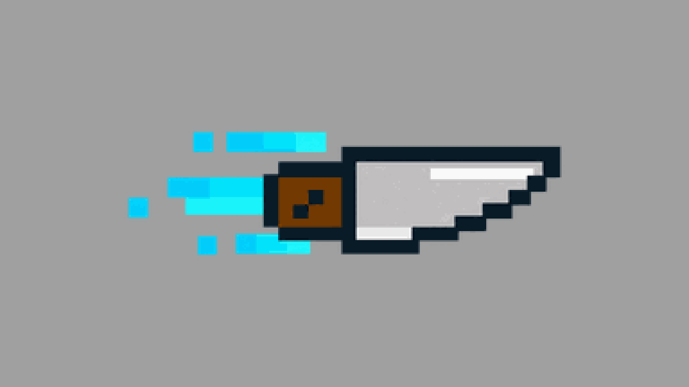
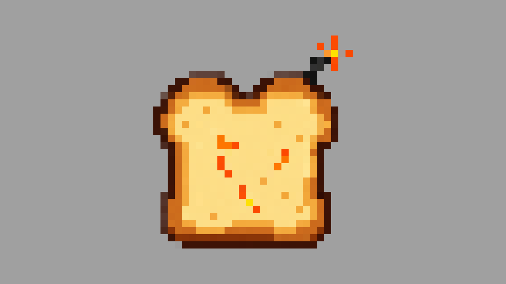
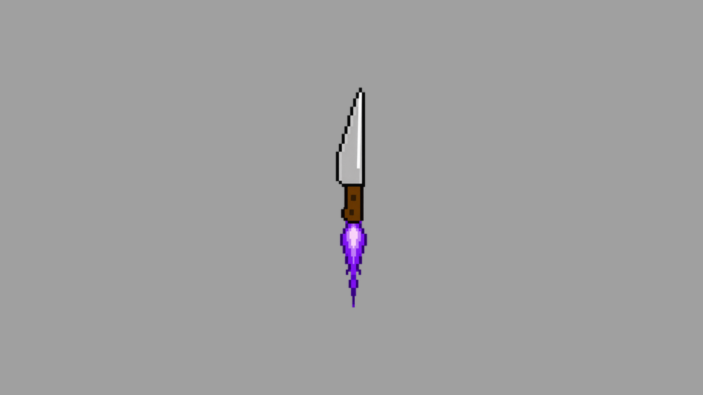
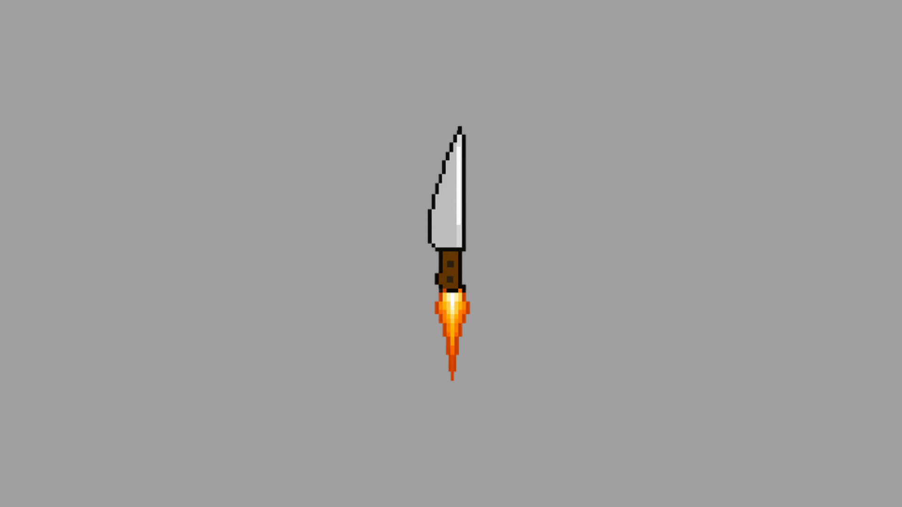
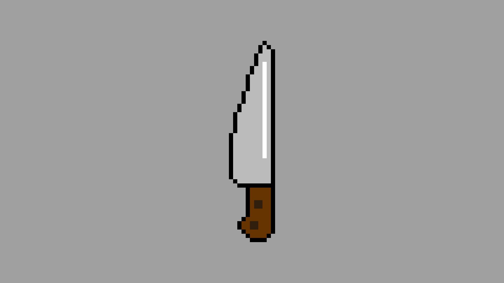

# Weapons And Attacks

[← Back to Toastator](../../README.md)

5 images. Created by **Maximilian Vincentius**. One image per row.

| Basic Attack |
| :---: |
|  |

| Explosive Toast |
| :---: |
|  |

| Knife Level 2 |
| :---: |
|  |

| Knife Level 3 |
| :---: |
|  |

| Throwing Knife |
| :---: |
|  |

## License

All rights reserved. See [LICENSE.txt](../../LICENSE.txt) for portfolio viewing terms.
