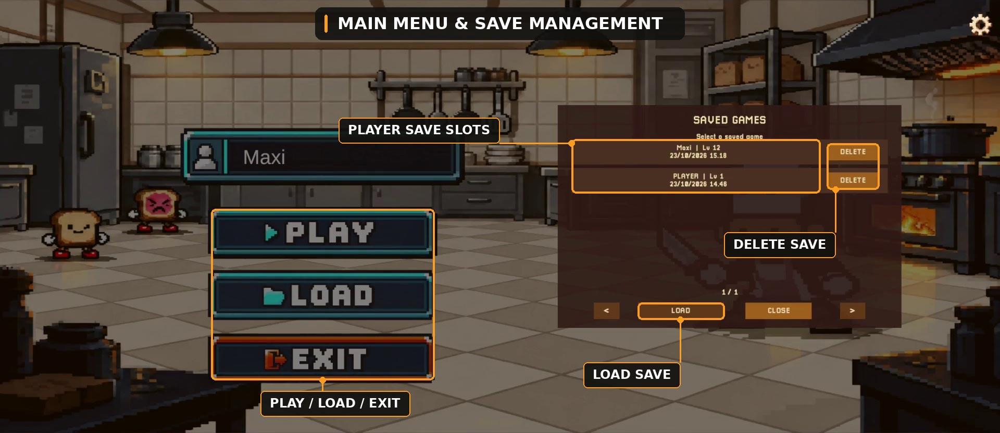
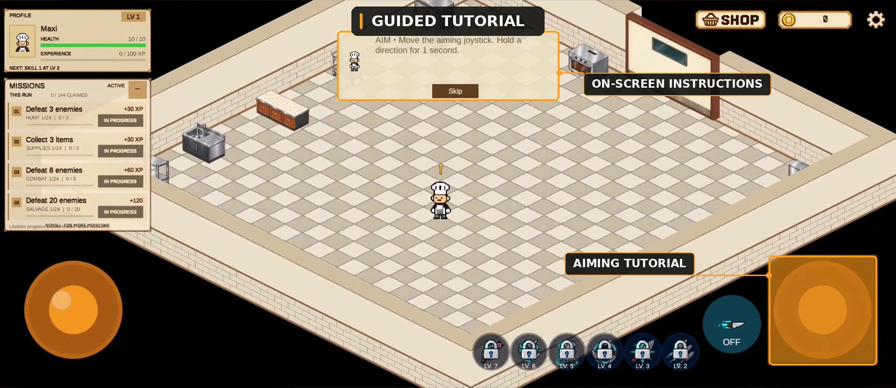
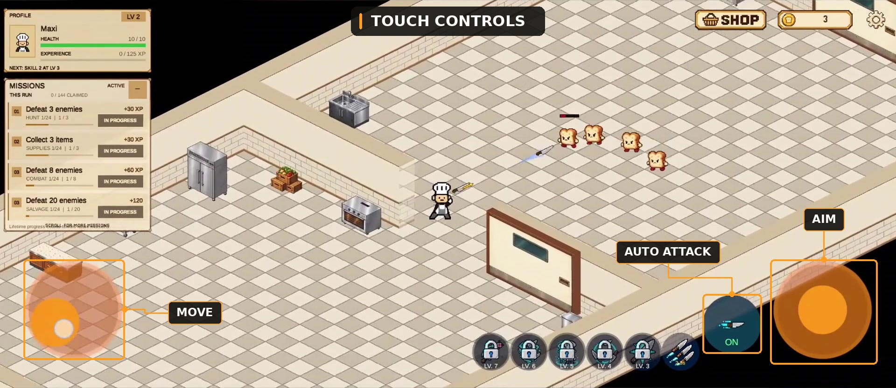
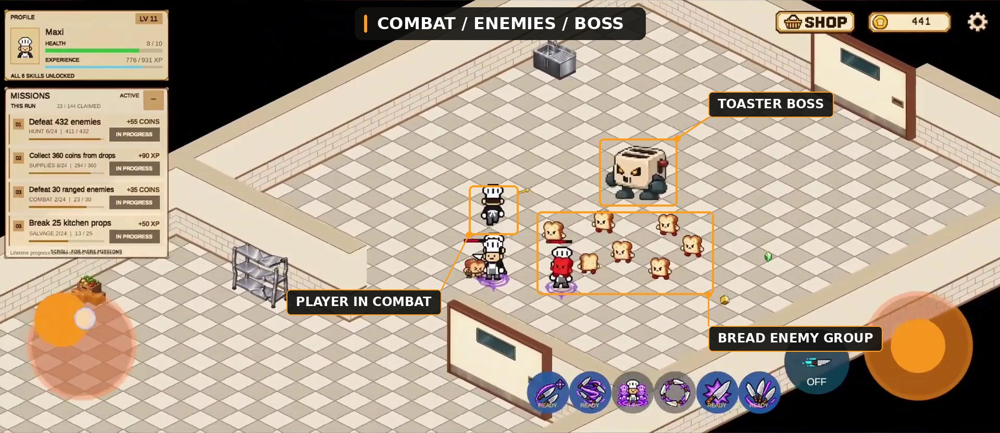
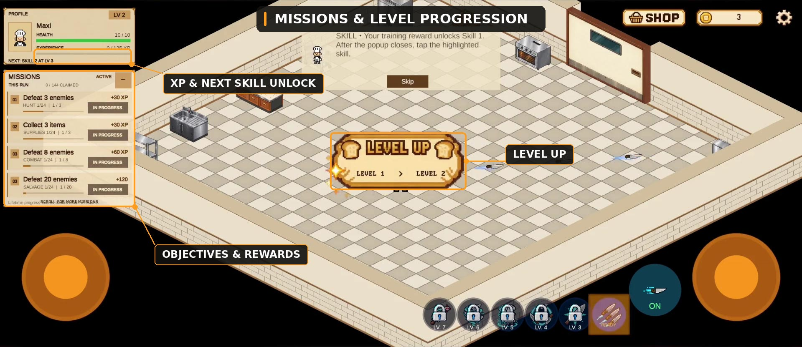
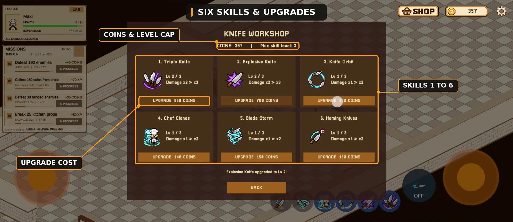
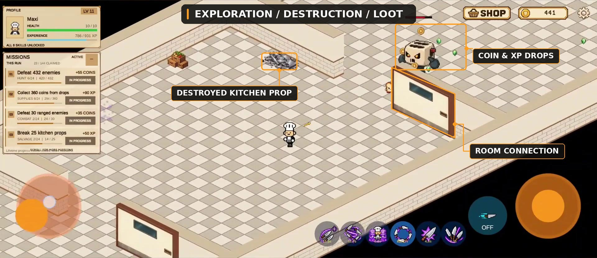
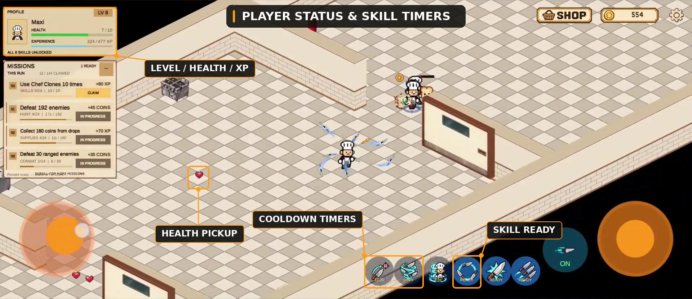
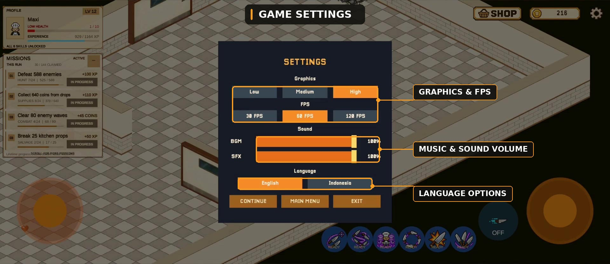
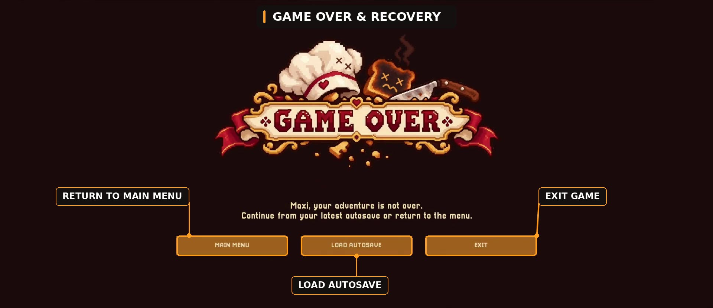

# Game Features

[← Back to Toastator](../../README.md)

10 feature screenshots. Created by **Maximilian Vincentius**. One image per row.

| **Main Menu & Save Management** |
| :---: |
|  |

| **Guided Tutorial** |
| :---: |
|  |

| **Touch Controls** |
| :---: |
|  |

| **Combat, Enemies & Boss** |
| :---: |
|  |

| **Missions & Level Progression** |
| :---: |
|  |

| **Six Skills & Upgrades** |
| :---: |
|  |

| **Exploration, Destruction & Loot** |
| :---: |
|  |

| **Player Status & Skill Timers** |
| :---: |
|  |

| **Game Settings** |
| :---: |
|  |

| **Game Over & Recovery** |
| :---: |
|  |

## License

All rights reserved. See [LICENSE.txt](../../LICENSE.txt) for portfolio viewing terms.
